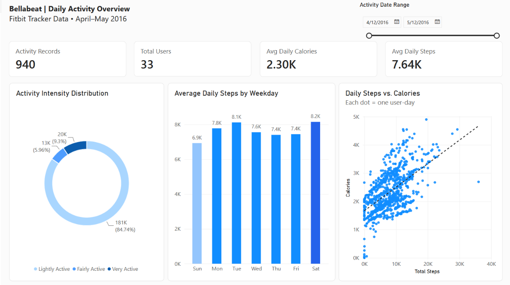
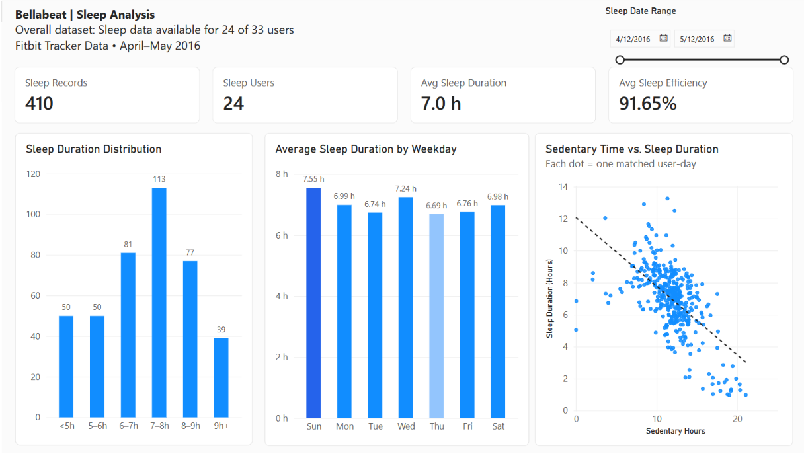

# bellabeat-data-analysis
Google Data Analytics Capstone Case Study — Bellabeat Marketing Analysis

## Power BI Dashboard Preview

### Daily Activity Overview

### Sleep Analysis

## 1. Ask

### Business Context

Bellabeat is a health-focused technology company that develops smart wellness products for women. The company aims to identify new growth opportunities in the global smart device market.

This project is a simulated business case study completed as part of the Google Data Analytics Capstone. It does not represent actual employment or commissioned work for Bellabeat.

### Business Task

The objective of this case study is to analyze non-Bellabeat smart device usage data to identify consumer behavior trends and understand how these insights could inform Bellabeat's marketing strategy.

The analysis will examine Fitbit smart device usage data and apply the findings to a selected Bellabeat product to develop data-driven marketing recommendations.

### Business Questions

1. What are some trends in smart device usage?
2. How could these trends apply to Bellabeat customers?
3. How could these trends help influence Bellabeat's marketing strategy?

### Key Stakeholders

The following stakeholders are identified in the case study scenario:

- **Urška Sršen:** Co-founder and Chief Creative Officer of Bellabeat.
- **Sando Mur:** Co-founder and key member of the executive team.
- **Bellabeat Marketing Analytics Team:** Responsible for collecting, analyzing, and communicating data to support marketing decisions.
- **Bellabeat Executive Team:** The intended audience for the final findings and recommendations.

### Expected Outcome

The expected outcome is to identify meaningful trends in smart device usage and translate them into actionable, high-level marketing recommendations for a selected Bellabeat product.

These recommendations will be based on the available data and its limitations.

## 2. Prepare

### Data Source

The dataset used in this case study is **FitBit Fitness Tracker Data**, publicly available on Kaggle and published by Mobius.

| Attribute | Description |
|---|---|
| Dataset | FitBit Fitness Tracker Data |
| Source | [Kaggle](https://www.kaggle.com/datasets/arashnic/fitbit) |
| Publisher | Mobius |
| License | CC0 — Public Domain |
| Collection Period 1 | March 12 – April 11, 2016 |
| Collection Period 2 | April 12 – May 12, 2016 |
| Data Categories | Daily activity, steps, calories, sleep, and heart rate measurements |

The initial exploration focuses on `dailyActivity_merged.csv` and `sleepDay_merged.csv` from the second collection period (April 12 – May 12, 2016).

### Dataset Overview

| Dataset | Records | Columns | Unique Users |
|---|---:|---:|---:|
| Daily Activity | 940 | 15 | 33 |
| Sleep Data | 413 | 5 | 24 |

**Daily Activity (`dailyActivity_merged.csv`)**

Contains daily activity measurements, including steps, distances, activity intensity, active and sedentary minutes, and calories.

**Sleep Data (`sleepDay_merged.csv`)**

Contains sleep-related measurements, including total sleep records, minutes asleep, and total time in bed.

**User Coverage**

- Both datasets cover April 12 – May 12, 2016.
- All 24 users in the sleep dataset also appear in the daily activity dataset.
- Nine users in the daily activity dataset have no records in the sleep dataset.

### Data Quality & Integrity

Data quality checks were performed on the daily activity and sleep datasets to assess missing values, duplicate records, date validity, and measurement consistency.

The data exploration and quality checks are documented in [01_data_exploration.ipynb](notebooks/01_data_exploration.ipynb).

| Quality Check | Daily Activity | Sleep Data |
|---|---:|---:|
| Missing Values | 0 | 0 |
| Exact Duplicate Records | 0 | 3 |
| Duplicate User-Date Records | 0 | 3 |
| Invalid Dates | 0 | 0 |
| Negative Measurements | 0 | 0 |

Additional consistency checks found:

- **Sleep Duration:** No records where minutes asleep exceeded total time in bed.
- **Sleep Records:** No records with non-positive sleep record counts.
- **Activity Duration:** No records where total recorded activity minutes exceeded 1,440 minutes.

**Key Finding:** Three exact duplicate records were identified in the sleep dataset. These duplicates will be reviewed and handled during the Process phase.

**Participant Count Discrepancy:** The dataset documentation mentions 30 participants, while the daily activity file contains 33 unique user IDs. This discrepancy should be considered when assessing the dataset's reliability.

The checks above did not identify additional issues, but they do not guarantee that the datasets are free from all possible data quality problems.

### Data Credibility (ROCCC Assessment)

The Fitbit dataset was evaluated using the ROCCC framework to assess its credibility and suitability for the Bellabeat case study.

| Criterion | Assessment |
|---|---|
| **Reliable** | The dataset contains recorded fitness tracker measurements, but its small sample size and limited participant information restrict its representativeness. |
| **Original** | The dataset was republished on Kaggle by Möbius. Its original publication was traced to Furberg et al. (2016) on Zenodo, with data collected through an Amazon Mechanical Turk survey. The original data collection was documented, but its accuracy has not been independently verified. |
| **Comprehensive** | The dataset includes activity and sleep measurements, but sleep data is available for only 24 of the 33 users identified in the activity dataset. |
| **Current** | The data was collected in 2016 and may not reflect current smart device usage patterns. |
| **Cited** | The dataset is publicly available on Kaggle, with an identifiable publisher and a CC0 license. |

#### Licensing & Privacy

- **License:** CC0 — Public Domain, permitting reuse and redistribution.
- **Privacy:** The analysis uses publicly available fitness tracker records and does not attempt to identify individual participants.
- **Data Handling:** Raw datasets are stored locally and excluded from Git tracking.
- **Accessibility:** The dataset is publicly accessible through Kaggle.

**Overall Assessment:** The dataset is suitable for exploratory analysis of smart device usage patterns. However, its limited sample size, historical nature, and incomplete sleep coverage must be considered when interpreting findings and developing marketing recommendations.

### Data Relevance

The selected Fitbit datasets provide information about daily activity and sleep patterns, which are relevant to the business questions of this case study.

These datasets will help explore consumer behavior and identify trends that may inform marketing recommendations for a selected Bellabeat product.

## 3. Process

### Tools & Technologies

Python, primarily through the Pandas library, was used to clean, transform, and validate the Fitbit datasets. Jupyter Notebook provided a reproducible workflow for documenting the cleaning process and verifying the results.

| Tool | Purpose |
|---|---|
| Python (Pandas) | Data cleaning, transformation, and validation |
| Jupyter Notebook | Executing and documenting the cleaning workflow |
| VS Code | Development environment |
| Git & GitHub | Version control and project documentation |

The cleaning process is documented in [02_data_cleaning.ipynb](notebooks/02_data_cleaning.ipynb).

### Data Cleaning & Transformation

The Fitbit datasets were cleaned and transformed using Pandas while preserving the original CSV files.

**Date Conversion**

- Converted `ActivityDate` in the daily activity dataset from `object` to `datetime`.
- Converted `SleepDay` in the sleep dataset from `object` to `datetime`.
- Verified that both conversions completed without producing invalid or missing dates.

**Duplicate Removal**

- Identified three exact duplicate records in the sleep dataset.
- Removed the duplicate records using `drop_duplicates()`, retaining one copy of each record.
- Reset the DataFrame index after removing duplicates.
- No duplicate records were found in the daily activity dataset.

| Dataset | Rows Before | Rows After | Rows Removed |
|---|---:|---:|---:|
| Daily Activity | 940 | 940 | 0 |
| Sleep Data | 413 | 410 | 3 |

The original datasets were preserved in `data/raw/`, while all cleaning operations were performed on separate working copies.

### Post-Cleaning Validation

After cleaning, both datasets were validated to confirm that the transformations were successful and that data integrity was maintained.

| Validation Check | Daily Activity | Sleep Data |
|---|---:|---:|
| Final Records | 940 | 410 |
| Unique Users | 33 | 24 |
| Missing Values | 0 | 0 |
| Exact Duplicate Records | 0 | 0 |
| Duplicate User-Date Records | 0 | 0 |
| Negative Measurements | 0 | 0 |

Additional consistency checks confirmed:

- **Sleep Duration:** No records where minutes asleep exceeded total time in bed.
- **Sleep Records:** No records with non-positive sleep record counts.
- **Activity Duration:** No records where total recorded activity minutes exceeded 1,440 minutes.

Both date columns were successfully converted to `datetime` without introducing invalid dates.

**Validation Result:** All performed checks passed. The cleaned datasets are ready for exploratory analysis, although these checks do not guarantee that every recorded measurement is accurate.

### Cleaned Datasets

The cleaned datasets were exported as CSV files to the `data/processed/` directory for use in the Analyze phase.

| Dataset | File | Records |
|---|---|---:|
| Daily Activity | [daily_activity_cleaned.csv](data/processed/daily_activity_cleaned.csv) | 940 |
| Sleep Data | [sleep_cleaned.csv](data/processed/sleep_cleaned.csv) | 410 |

Both exported files were successfully reloaded using Pandas, and their row counts were verified against the cleaned DataFrames.

The original datasets remain unchanged in `data/raw/`, which is excluded from Git tracking. The processed datasets are included in the GitHub repository to support reproducibility.

**Note:** CSV files do not preserve Pandas data types. Date columns will be parsed as `datetime` when loading the cleaned datasets for analysis.

## 4. Analyze

This phase examines daily physical activity, sleep patterns, and the relationships between activity and sleep using Python (Pandas) and PostgreSQL.

Python was used for exploratory and statistical analysis, while SQL provided complementary insights into sleep-record coverage and differences in activity across tracking groups.

**Analysis Files:**
- [Exploratory Data Analysis Notebook](notebooks/03_exploratory_data_analysis.ipynb)
- [SQL Analysis](sql/bellabeat_analysis.sql)

### 4.1 Daily Activity Findings

- **Daily Steps:** The average was **7,637.91 steps per daily record**, compared with **7,519.27 steps** when averaging individual users' daily step averages.
- **Activity Intensity:** Light activity accounted for **84.74% of recorded active minutes**.
- **Steps and Calories:** A moderate positive correlation was observed between daily steps and calories burned (**r = 0.592**).
- **Weekly Activity Patterns:** Saturday had the highest average daily steps (**8,152.98**), while Sunday had the lowest (**6,933.23**).

### 4.2 Sleep & Activity Findings

- **Sleep Duration:** Average recorded sleep duration was **419.17 minutes (approximately 6 hours and 59 minutes)** per sleep record.
- **Sleep Efficiency:** The average ratio of time asleep to time in bed was **91.65%**.
- **Weekly Sleep Patterns:** Sunday had the highest average sleep duration (**452.75 minutes**), while Thursday had the lowest (**401.30 minutes**).
- **Steps and Sleep:** A weak negative correlation was observed (**r = -0.190**).
- **Sedentary Time and Sleep:** A moderate-to-strong negative correlation was observed (**r = -0.601**). Tracking conventions and time-use constraints may influence this association.

These correlations describe relationships within the dataset and do not establish causation.

### 4.3 SQL Analysis Findings

PostgreSQL was used to investigate sleep-record availability across users and weekdays using `LEFT JOIN`, Common Table Expressions (CTEs), `CASE WHEN`, and aggregation functions.

**Sleep Tracking Coverage**

Among the **33 activity users**:

- **3 users** had matching sleep records for every recorded activity day.
- **21 users** had partial sleep-record coverage.
- **9 users** had no sleep records.

**Activity by Sleep Tracking Group**

| Tracking Group | Users | Average Daily Steps |
|---|---:|---:|
| Complete Coverage | 3 | 9,041.70 |
| No Sleep Records | 9 | 7,860.03 |
| Partial Coverage | 21 | 7,155.75 |

The averages above represent the equal-weighted mean of each user's average daily steps.

Users with complete sleep-record coverage had the highest average daily steps. However, this group contained only three users, limiting the strength of comparisons.

**Sleep-Record Coverage by Weekday**

| Day | Activity Records | Matched Sleep Records | Coverage Rate |
|---|---:|---:|---:|
| Monday | 120 | 46 | 38.33% |
| Tuesday | 152 | 65 | 42.76% |
| Wednesday | 150 | 66 | 44.00% |
| Thursday | 147 | 64 | 43.54% |
| Friday | 126 | 57 | 45.24% |
| Saturday | 124 | 57 | 45.97% |
| Sunday | 121 | 55 | 45.45% |

Saturday had the highest matching sleep-record coverage (**45.97%**), while Monday had the lowest (**38.33%**).

These rates measure the availability of matching sleep records, not confirmed wearable usage or adherence to sleep tracking.

### 4.4 Analytical Limitations

- The dataset contains **940 activity records from 33 users** and **410 sleep records from 24 users**.
- User-level recording coverage varies, which may affect averages and group comparisons.
- The data covers approximately one month in **2016**, limiting its relevance to current consumer behavior.
- The Fitbit participants are not necessarily representative of Bellabeat customers.
- Correlations and group differences are observational and should not be interpreted as causal effects.

